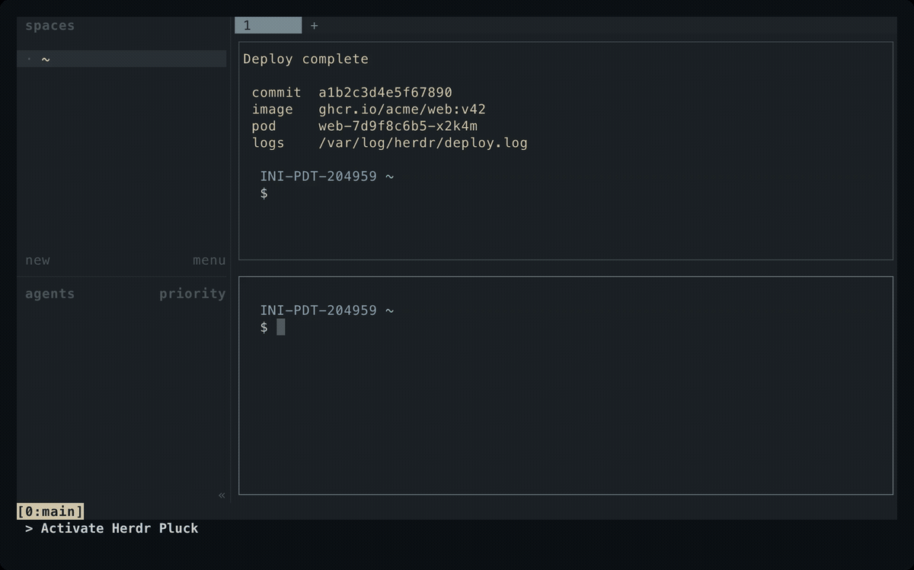

# Herdr Pluck

Herdr Pluck is a Herdr plugin for quickly copying visible terminal tokens or opening visible URLs with short keyboard hints, inspired by `tmux-fingers`.

Invoke an action while a pane is focused and type the displayed hint for the item you want. The pluck action copies the selected text to the clipboard of the machine you are viewing Herdr from, including over `herdr --remote`, while the URL action opens the selection in your default browser. Escape or Ctrl-C cancels.



## Requirements

- Herdr 0.7.4 or newer
- For release installs, a download tool:
    - `curl` or `wget`
- Rust/Cargo only when forcing a source build or when no matching prebuilt binary is available
- Only with `clipboard = "system"` (see [Clipboard](#clipboard)), a clipboard command on the machine running the Herdr server:
    - macOS: `pbcopy`
    - Linux Wayland: `wl-copy`
    - Linux X11: `xclip` or `xsel`
- For opening URLs, on the machine running the Herdr server:
    - macOS: `open`
    - Linux: `xdg-open`

## Install

From the remote repository:

```bash
herdr plugin install rmarganti/herdr-pluck
```

Published releases provide prebuilt binaries for these targets:

- macOS Apple Silicon: `aarch64-apple-darwin`
- Linux x86_64: `x86_64-unknown-linux-musl`

To install a specific branch, tag, or commit, pass `--ref`:

```bash
herdr plugin install rmarganti/herdr-pluck --ref main
```

Install first downloads the GitHub Release asset matching the version in `herdr-plugin.toml`. If that asset is unavailable, it falls back to a local Cargo build when Rust is available.

From this checkout:

```bash
herdr plugin link .
```

By default, linking also installs the prebuilt binary matching `herdr-plugin.toml`. To build the checked-out source instead:

```bash
HERDR_PLUCK_BUILD_FROM_SOURCE=1 herdr plugin link .
```

Verify Herdr can see the action:

```bash
herdr plugin action list --plugin rmarganti.herdr-pluck
```

The action ids are:

```text
rmarganti.herdr-pluck.pluck
rmarganti.herdr-pluck.open-url
```

## Keybinding

Add a Herdr `plugin_action` binding to your Herdr config, choosing any free key you prefer:

```toml
[[keys.command]]
key = "prefix+q"
type = "plugin_action"
command = "rmarganti.herdr-pluck.pluck"
description = "pluck visible token"
```

To bind the dedicated URL action separately:

```toml
[[keys.command]]
key = "prefix+o"
type = "plugin_action"
command = "rmarganti.herdr-pluck.open-url"
description = "open visible URL"
```

Reload Herdr config after editing:

```bash
herdr server reload-config
```

## Usage

1. Focus a Herdr pane containing a URL, path, commit SHA, UUID, IP address, long numeric identifier, hex literal, Kubernetes reference, Git status path, branch, or diff path.
2. Invoke `rmarganti.herdr-pluck.pluck` through your keybinding or Herdr's plugin action command.
3. Herdr Pluck opens a temporary picker tab that mirrors the source layout and shows hints over copyable text in the target pane.
4. Type the shown one- or two-letter hint to copy that token and close the picker.
5. Press Escape or Ctrl-C to cancel without copying.

The `open-url` action uses the same picker flow, but shows only `http://`, `https://`, and `file://` URLs and opens the selected URL through the system default handler without changing the clipboard.

You can also invoke either action from the CLI:

```bash
herdr plugin action invoke rmarganti.herdr-pluck.pluck
herdr plugin action invoke rmarganti.herdr-pluck.open-url
```

## What gets matched

Herdr Pluck recognizes these built-in token types, in priority order:

1. URLs
2. Git status paths, Git upstream branch names, and diff paths
3. Kubernetes resource references such as `pod/nginx` or `deployment.apps/frontend`
4. File paths
5. UUIDs
6. Deployment-managed Kubernetes pod names
7. Git SHAs
8. Hex literals such as `0xdeadBEEF`
9. IPv4 addresses
10. Long numeric identifiers

When identical text appears more than once, every visible occurrence shows the same hint and copies the same text.

Add your own token types with [custom patterns](#custom-patterns).

## Configuration

Herdr Pluck reads an optional global config file from its Herdr plugin config directory:

```bash
CONFIG_DIR="$(herdr plugin config-dir rmarganti.herdr-pluck)"
$EDITOR "$CONFIG_DIR/config.toml"
```

The file is read each time an action runs, so changes apply on the next invoke without reloading Herdr.

Every key is optional. This example sets each one to its default and adds one custom pattern:

```toml
# Top-level keys must come before any [table] or [[array]] header;
# otherwise TOML assigns them to that table.
clipboard = "osc52"                    # or "system"

[project]
patterns = true                        # look for project-local pattern files
pattern_files = [".herdr-pluck.toml"]  # file names to look for

[[patterns]]
name = "jira"
regex = "\\b[A-Z][A-Z0-9]+-[0-9]+\\b"
priority = 25                          # lower wins overlapping matches
```

Unknown or misplaced keys are errors. If the global config fails to load, Herdr Pluck falls back to the defaults for every setting, which also drops your custom patterns, and logs why:

```bash
herdr plugin log list --plugin rmarganti.herdr-pluck
```

### Clipboard

- `clipboard = "osc52"` (default) copies to the clipboard of the machine you are viewing Herdr from. Herdr Pluck hands the text to Herdr with an OSC 52 escape sequence, and Herdr forwards it to your client, including over `herdr --remote`.
- `clipboard = "system"` copies to the clipboard of the machine running the Herdr server, with `pbcopy`, `wl-copy`, `xclip`, or `xsel`.

### Custom patterns

Each `[[patterns]]` entry adds a token type:

- `name` identifies the pattern.
- `regex` uses Rust regular expression syntax. If a named capture called `match` is present, only that capture is copied; otherwise the whole match is copied.
- `priority` decides overlapping matches; lower wins. It defaults to `25`, between paths (`20`) and UUIDs (`30`). Built-ins range from URLs (`10`) to long numbers (`60`).

For example, this pattern highlights and copies only `abc123` in `trace_id=abc123`:

```toml
[[patterns]]
name = "trace-id"
regex = "trace_id=(?<match>[A-Za-z0-9_-]+)"
priority = 25
```

### Project-local patterns

Herdr Pluck also looks for `.herdr-pluck.toml` from the focused pane's working directory up to the Git root, and uses the first one it finds. Change the file names or turn this off with the global `[project]` table.

Project-local files only use `[[patterns]]`; any other settings in them are ignored. For equal-priority overlaps, project-local patterns win over global ones, which win over built-ins. A project file that fails to load is skipped; global and built-in patterns still apply.

## Releasing binaries

Tag releases as `vX.Y.Z`. GitHub Actions validates the crate, builds release archives, and uploads platform binaries to the matching GitHub Release.

## Troubleshooting

If invoking the action does nothing useful, check that the plugin is linked and the installed binary exists:

```bash
herdr plugin link .
ls -l ./bin/herdr-pluck
herdr plugin action list --plugin rmarganti.herdr-pluck
```

If no release asset matches the plugin version, make sure Rust/Cargo is available for the local fallback build. Set `HERDR_PLUCK_BUILD_FROM_SOURCE=1` to skip the release download and build the checked-out source explicitly.

If a copy doesn't reach your clipboard, check that copying a mouse selection in Herdr works on the machine you are viewing from; the default `osc52` clipboard relies on the same Herdr forwarding. With `clipboard = "system"`, install one of the supported clipboard tools on the server's machine.
